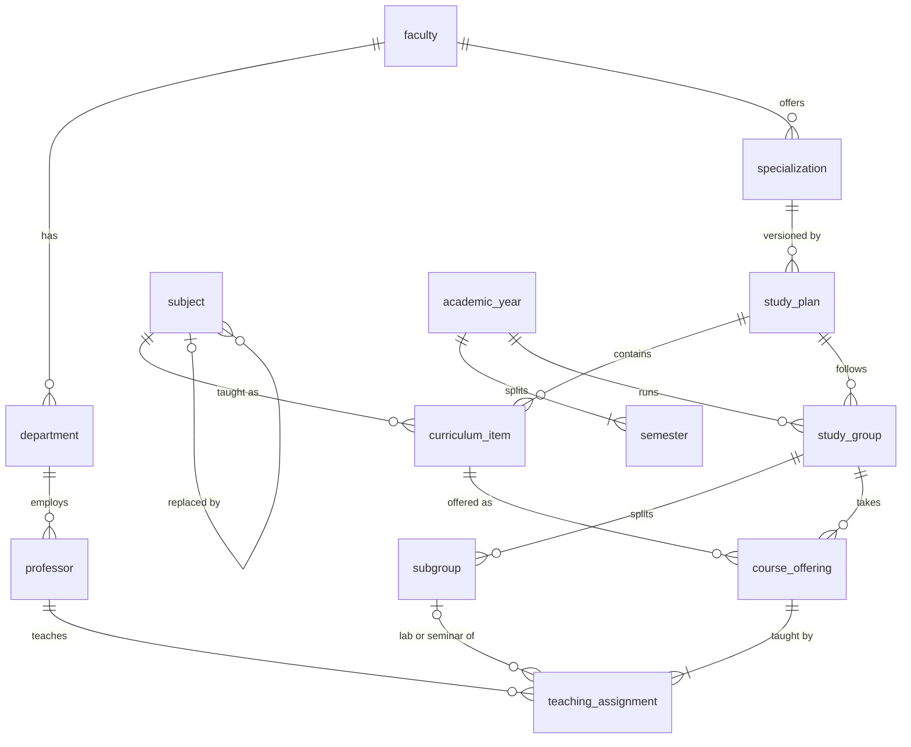
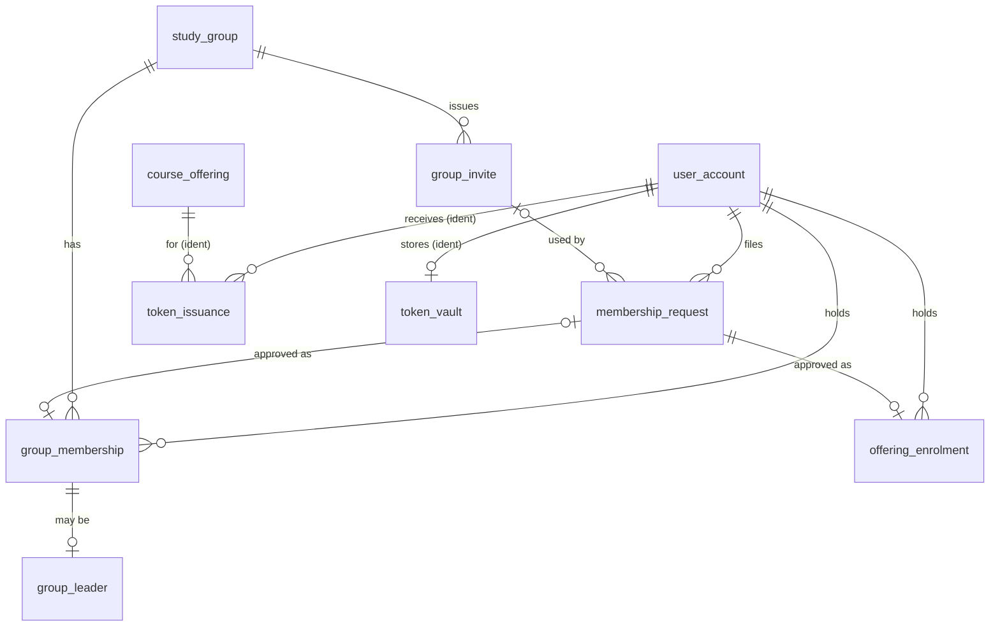
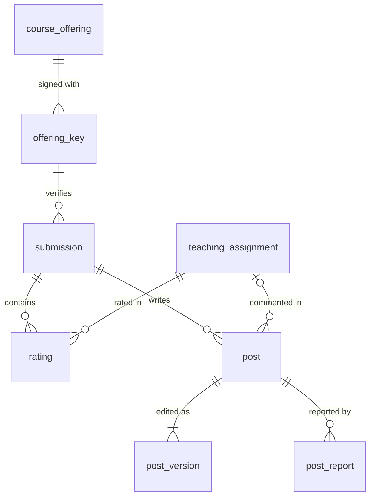

# ACIEE Advisor — Database Design

PostgreSQL 18. This document is the logical and physical design: entities, keys, normal forms, constraints, indexes, connections and query rules. The changesets in `backend/src/main/resources/db/changelog/` implement it; when the two disagree, fix one of them in the same commit.

## 1. Design rules

1. **3NF by default, BCNF where it costs nothing.** Every non-key column depends on the key, the whole key and nothing but the key.
2. **Redundancy only as a pinned key.** A column that copies a fact from another table is allowed only when it is part of a composite foreign key to that table. The FK makes the copy impossible to get wrong, so the update anomaly that normal forms prevent cannot happen. §4 lists every such column.
3. **Constraints over triggers, triggers over application code.** If the database can reject bad data declaratively, it does.
4. **History is modelled, not overwritten.** Validity ranges (`daterange`, `int4range`) with temporal keys instead of `is_current` flags.
5. **No speculative indexes.** Every index in the schema answers a query in §6 or backs a constraint. Demo-only indexes live in the Stage 4 scripts.
6. **No derived counters.** Counts are computed (`count(*)`, `EXISTS`) or materialised nightly, never kept in a column a trigger updates.

## 2. Schemas, roles and grants

| Schema | Holds |
|---|---|
| `ref` | Lookup tables and the one-row `setting` table |
| `core` | Organisation, curriculum, teaching, accounts, groups, sessions, audit |
| `ident` | Token issuance, token vault |
| `anon` | Offering keys, submissions, ratings, posts, aggregates |

All objects are owned by the migrator (ARCHITECTURE §4). Domains (§3.1) live in `ref`; the `ro_ro` ICU collation in `core`.

**Status (W2).** Roles, grants, RLS policies and per-role limits are in changeset `012-access`; the app connects as `aciee_ident`. The anon pool comes with redemption in W3.

| Object | `aciee_ident` | `aciee_anon` | `aciee_report` |
|---|---|---|---|
| `ref.*` | SELECT | SELECT | SELECT |
| Public `core` tables: organisation, curriculum, `professor`, `teaching_assignment`, `core.offering_v` | SELECT, DML | SELECT; REFERENCES on `course_offering`, `teaching_assignment` | — |
| Personal `core` tables: `user_account`, `email_verification`, `user_role`, `group_*`, `membership_request`, `offering_enrolment`, `spring_session*`, `audit_log` | SELECT, DML (RLS: ARCHITECTURE §4) | — | — |
| `ident.*` | SELECT, DML | — | — |
| `anon` base tables | — | SELECT, DML | — |
| `anon` views: `published_post`, `moderation_queue` | — | SELECT | — |
| Materialised views | — | SELECT; EXECUTE on `anon.refresh_aggregates()` | SELECT |

- `anon` references `core` only through the public tables, never `user_account`. No FK path leads from `anon` to an account, and the anonymous role cannot read one.
- Moderation runs on the `anon` pool through `anon.moderation_queue`, a view that omits `key_hash`. The application checks the moderator role before running it, because no user identity reaches the `anon` pool.
- The materialised views are refreshed by `anon.refresh_aggregates()`, a `SECURITY DEFINER` function owned by the migrator with its own `statement_timeout` (§9).

## 3. Logical model

### 3.1 Shared types (domains)

A domain is a named type with its constraint attached, defined once and reused.

| Domain | Base | Constraint | Used by |
|---|---|---|---|
| `score` | `smallint` | `0..10` | 14 rating axes, survival scales |
| `pct` | `smallint` | `0..100` | curriculum weights |
| `sha256` | `bytea` | `octet_length = 32` | `key_hash`, token and key fingerprints |
| `week_start` | `date` | `extract(isodow) = 1` | every coarse date in `anon` and on issuance |

Changing a domain's CHECK re-validates every column that uses it (3M rows for `score`), so domains are treated as fixed.

### 3.2 Lookup tables vs CHECK

- **Lookup table in `ref`** (text natural key, so reading a row needs no join): when the value has a UI label or the set can grow. Examples: `component`, `academic_title`, `exam_format`, `attendance_usefulness`, `moderation_reason`, `report_reason`, `pillar`, `axis`, `app_role`, `membership_kind`.
- **CHECK**: when the set is closed and code branches on it. Examples: `degree IN ('BSc','MSc')`, `semester.no IN (1,2)`, every `status` column.
- **Never PostgreSQL `ENUM`**: values cannot be removed or reordered without rewriting the type.
- `ref.setting` is a one-row table (`CHECK (id = 1)`) holding values the views read, starting with `k_threshold = 5`.

### 3.3 Organisation and time (`core`)

| Table | Key | Columns | Notes |
|---|---|---|---|
| `faculty` | `id` | `code` UQ, `name_ro` | One row (ACIEE) today. Lets the platform take another faculty without a schema change. |
| `department` | `id` | `faculty_id`, `name_ro`; UQ(`faculty_id`, `name_ro`) | |
| `specialization` | `id` | `faculty_id`, `code` UQ, `name_ro`, `degree`, `duration_years` | |
| `academic_year` | `id` | `during daterange` | `EXCLUDE USING gist (during WITH &&)` |
| `semester` | `id` | `academic_year_id`, `no`, `during`, `rating_opens_at`; UQ(`academic_year_id`, `no`) | `UNIQUE (academic_year_id, during WITHOUT OVERLAPS)`. That the semester lies inside its year is checked by the admin CRUD, not the database. |

### 3.4 Curriculum (`core`)

| Table | Key | Columns | Notes |
|---|---|---|---|
| `subject` | `id` | `code` UQ, `name_ro`, `name_en`, `replaced_by_id` → `subject` | `CHECK (replaced_by_id <> id)`. Longer cycles are cut by the `CYCLE` clause in §8. |
| `study_plan` | `id` | `specialization_id`, `intake int4range` | The curriculum a cohort follows, by intake year. `UNIQUE (specialization_id, intake WITHOUT OVERLAPS)` |
| `curriculum_item` | `id` | `plan_id`, `subject_id`, `study_year`, `semester_no`, `elective_slot` NULL, `lab_pct`, `exam_pct`, `project_pct`; UQ(`plan_id`, `subject_id`); UQ(`id`, `plan_id`, `study_year`) | `CHECK (lab_pct + exam_pct + project_pct = 100)`. An elective package is the set of items sharing (`plan_id`, `study_year`, `semester_no`, `elective_slot`), so its options cannot span years or semesters. |
| `study_group` | `id` | `plan_id`, `academic_year_id`, `study_year`, `code`, `max_size`; UQ(`academic_year_id`, `code`); UQ(`id`, `plan_id`, `study_year`) | Specialisation is reached through the plan. |
| `subgroup` | `id` | `group_id`, `label`; UQ(`group_id`, `label`); UQ(`id`, `group_id`) | |
| `course_offering` | `id` | `curriculum_item_id`, `group_id`, pinned `plan_id`, `study_year`, `title_snapshot`; UQ(`curriculum_item_id`, `group_id`); UQ(`group_id`, `id`) | One course taught to one group. Its semester is `semester(academic_year_id, no)` = (group's `academic_year_id`, item's `semester_no`). |

`core.group_v` names a group with its specialisation and academic-year label the same way. `core.offering_v` joins offering, item, subject, group and semester into one row, so every screen and the defence use one name for "an offering with its subject and semester". It is a plain view, not materialised.

### 3.5 Teaching (`core`)

| Table | Key | Columns | Notes |
|---|---|---|---|
| `professor` | `id` | `full_name` (ICU `ro-RO` collation, created in a changeset), `title_code` → `ref.academic_title`, `department_id`, `slug` UQ, `archived_at` | No unique name: namesakes exist. |
| `teaching_assignment` | `id` | `offering_id`, pinned `group_id`, `professor_id`, `component` → `ref.component`, `subgroup_id` NULL, `valid_during`; UQ(`offering_id`, `id`) | `CHECK (component <> 'lecture' OR subgroup_id IS NULL)`. FK (`group_id`, `offering_id`) → `course_offering(group_id, id)`. FK (`subgroup_id`, `group_id`) → `subgroup`. `professor_id ON DELETE RESTRICT`. |

### 3.6 Accounts and groups (`core`)

| Table | Key | Columns | Notes |
|---|---|---|---|
| `user_account` | `id` | `email`, `email_normalized` (`GENERATED ALWAYS AS (core.normalize_email(email)) STORED`) UQ, `password_hash` NULL, `entra_oid` UQ NULL, `created_at`, `disabled_at` | `CHECK (password_hash IS NOT NULL OR entra_oid IS NOT NULL)`; domain CHECK on `@student.ugal.ro` |
| `email_verification` | `user_id` | `code_hash`, `sent_at`, `attempts` | One pending code per user. A separate table, because the data is short-lived and would otherwise be NULL columns on every account. |
| `user_role` | (`user_id`, `role_code`) | | Global roles. Group leadership is scoped, so it lives in `group_leader`. |
| `group_invite` | `id` | `group_id`, `token_hash` UQ, `expires_at`, `max_uses`, `created_by` | Uses are counted from `membership_request`, not stored. |
| `membership_request` | `id` | `user_id`, `group_id`, `subgroup_id` NULL, `offering_id` NULL, `kind`, `invite_id` NULL, `status`, `decided_by`, `decided_at` | Workflow state. With `offering_id` set, it asks for one course only (a repeated course). FK (`group_id`, `offering_id`) → `course_offering`; FK (`subgroup_id`, `group_id`) → `subgroup`. |
| `group_membership` | `id` | `user_id`, `group_id`, `subgroup_id`, `kind`, `source` (`request` / `university_sync`, `CHECK ((source = 'request') = (request_id IS NOT NULL))`), `request_id` UQ NULL, `valid_during` | Approved facts only, so no `status` column. `UNIQUE (user_id, valid_during WITHOUT OVERLAPS)`: one home group at a time, while leaving and re-joining a group is two rows. FK (`subgroup_id`, `group_id`) → `subgroup`. `request_id` is NULL for future `university_sync` rows. |
| `offering_enrolment` | (`user_id`, `offering_id`) | `request_id` UQ | A repeated course taken with another group. Grants a token for that offering only. |
| `group_leader_claim` | `id` | `user_id`, `group_id`, `status`, `decided_by`, `decided_at` | |
| `group_leader` | `membership_id` | `claim_id` UQ | A leader is a membership. Leadership ends when that membership's `valid_during` ends; policies check `valid_during @> current_date`. |
| `spring_session`, `spring_session_attributes` | Spring's | Spring's | Created by a changeset, not by Spring at startup. |
| `audit_log` | (`id`, `created_at`) | `actor_user_id`, `table_name`, `row_id`, `op`, `old jsonb`, `new jsonb` | Range-partitioned by month, no DEFAULT partition (§7). |

### 3.7 Identified token data (`ident`)

| Table | Key | Columns | Notes |
|---|---|---|---|
| `token_issuance` | (`user_id`, `offering_id`) | `issued_week week_start`, `blinded_msg`, `blind_sig` | One token per offering. A lost response is retried by returning the stored blind signature. Blinded values cannot be linked to the final token (RFC 9474 blindness). |
| `token_vault` | `user_id` | `ciphertext`, `nonce`, `updated_at` | |

### 3.8 Anonymous data (`anon`)

| Table | Key | Columns | Notes |
|---|---|---|---|
| `offering_key` | `fingerprint sha256` | `offering_id`, `public_key bytea`, `active boolean` | `UNIQUE (offering_id) WHERE active`: one active key per offering, so a key can be rotated. |
| `submission` | `key_hash sha256` | `offering_id`, `key_fingerprint` → `offering_key`, survival columns (`exam_difficulty score`, `labs_help score`, `attendance_useful`, `weekly_hours`, `exam_format`, `attendance_strictness score`); UQ(`key_hash`, `offering_id`) | One per token (ADR-011). All tokens of an offering share a key, so `key_fingerprint` reveals nothing new. |
| `rating` | (`key_hash`, `teaching_assignment_id`) | pinned `offering_id`, `a01..a14 score` | FK (`key_hash`, `offering_id`) → `submission` `ON DELETE CASCADE`. FK (`offering_id`, `teaching_assignment_id`) → `teaching_assignment`: a token can rate only its own offering's teachers. `CHECK (num_nonnulls(a01..a14) >= 1)` |
| `post` | `id uuid` (v4) | `key_hash`, pinned `offering_id`, `kind`, `teaching_assignment_id` NULL; UQ(`id`, `kind`); UQ(`key_hash`, `teaching_assignment_id`) | Course tips and teaching comments in one table. FK (`key_hash`, `offering_id`) → `submission` `ON DELETE CASCADE`. FK (`offering_id`, `teaching_assignment_id`) → `teaching_assignment`, as on `rating`. `CHECK ((kind = 'comment') = (teaching_assignment_id IS NOT NULL))`. At most one tip per submission (partial UQ on `key_hash WHERE kind = 'tip'`) and one comment per assignment per token. |
| `post_version` | (`post_id`, `version_no`) | pinned `kind`, `body`, `status`, `reason_code` NULL, `submitted_week`, `moderated_week` | Cascades from `post`. Each edit adds a version. The length CHECK depends on `kind` (1,000 / 280). `CHECK ((status = 'rejected') = (reason_code IS NOT NULL))` |
| `post_report` | `id uuid` (v4) | `post_id`, `reason_code`, `reported_week`, `status CHECK IN ('open','dismissed','upheld')` | Cascades from `post`. No reporter id: `anon` holds no account ids. |

**Weekly release.** A version is published when `status = 'approved' AND moderated_week < date_trunc('week', current_date)`. The `anon.published_post` view applies this, so release is a predicate and needs no batch job. It also checks that a comment's professor × subject pair has passed k.

Rules for `anon`: no sequences, no `uuidv7()` (PostgreSQL 18 has it natively, and it embeds a timestamp), no time finer than `week_start`, no audit trigger, `track_commit_timestamp = off`.

### 3.9 Relationships

## 4. Normal forms

**1NF.** Every column is atomic and there are no repeating groups. The 14 axes are 14 *different* attributes with their own meaning, not one attribute repeated (ADR-003). Validity ranges are single range values, not two loose dates.

**2NF.** Composite keys were checked for partial dependencies. For example, in `rating(key_hash, teaching_assignment_id)` every axis depends on the pair: the same student rates two teachers differently.

**3NF.** Changes made to the first sketch in the old `ARCHITECTURE.md` §4:

| Before | Dependency | Now |
|---|---|---|
| `curriculum_item.is_elective` | follows from the package / slot being set | dropped |
| `elective_package` table + 4-column FK | a package is only "items sharing a slot" | `curriculum_item.elective_slot` |
| `curriculum_item.valid_from_ay / valid_to_ay` | a property of the curriculum version, repeated on each item | `study_plan.intake` |
| `study_group.specialization_id` | `plan_id → specialization_id` | through `study_plan` |
| `course_offering.semester_id` | (group's academic year, item's `semester_no`) → semester | derived by join, named in `core.offering_v` |
| `course_offering.subject_id` | `curriculum_item_id → subject_id` | through `curriculum_item` |
| `professor.department` (text) | department attributes would repeat per professor | `department` table |
| `anon.submission.semester_bucket` | `offering_id → semester` | dropped |
| `anon.course_tip.offering_id` | `key_hash → offering_id` | `post`, pinned by FK |
| `group_membership.status, approved_by` | workflow state, not a membership fact | `membership_request` |
| `group_membership.is_leader` | a separate fact with its own approver | `group_leader` |
| tip/comment `body, status` with in-place edits | a version's state, not the post's | `post_version` |

**Deliberate redundancy** (rule 2). Each column below breaks 2NF or 3NF on paper. A composite FK keeps it equal to its source, so it can never drift:

| Column | Copies | Pinned by FK to | Why it is kept |
|---|---|---|---|
| `course_offering.plan_id, study_year` | the item's and the group's | `curriculum_item(id, plan_id, study_year)` and `study_group(id, plan_id, study_year)` | A group can only be offered courses of its own plan and year |
| `teaching_assignment.group_id` | the offering's group | `course_offering(group_id, id)` | The subgroup must belong to that group |
| `rating.offering_id`, `post.offering_id` | the submission's offering | `submission(key_hash, offering_id)` | A token can only rate or comment on its own offering's teachers |
| `post_version.kind` | the post's kind | `post(id, kind)` | The body length CHECK needs it |

**Not redundancy:**
- `course_offering.title_snapshot`. `subject_id` does not determine it, because names change. It records the name the offering ran under.
- The materialised views (§8). They are a cache that is fully rebuilt, never edited.

**BCNF.** Every determinant in the remaining tables is a candidate key. Natural keys stay as `UNIQUE` constraints next to surrogate `id`s (for example `subject.code`, `study_group(academic_year_id, code)`), so duplicate rows are rejected even with surrogate keys.

**Cost.** The course page is about 9 joins (offering → item → subject, group → semester, assignments → professor → title, aggregates, posts). Token issuance is 6 joins plus a `UNION` with `offering_enrolment`. At these volumes each join is an index lookup. `core.offering_v` hides the most common five.

## 5. Constraint catalogue (beyond PK/FK)

| Kind | Where | What it guarantees |
|---|---|---|
| Temporal UQ `WITHOUT OVERLAPS` (PG 18) | `group_membership(user_id, valid_during)`, `study_plan(specialization_id, intake)`, `semester(academic_year_id, during)` | One home group at a time; one plan per intake year; semesters of a year do not overlap |
| `EXCLUDE USING gist` | `academic_year(during)` | Academic years never overlap. A single-column range, so the temporal key syntax does not apply. |
| Composite FK | §4 pinned columns, subgroup ↔ group (assignments, requests, memberships) | Cross-table consistency without triggers |
| Partial UNIQUE | `membership_request(user_id, group_id) WHERE status = 'pending'`, one tip per submission, one active key per offering | No duplicate open requests; one tip each; key rotation without overlap |
| CHECK with `num_nonnulls` | `rating` | A rating has at least one axis |
| Stored generated column | `user_account.email_normalized` | The normalised email cannot drift and is indexable. PG 18 generated columns default to VIRTUAL, so `STORED` is written explicitly. |
| Domains | §3.1 | One definition of "a 0–10 score" |
| `ON DELETE CASCADE` | `anon`: `submission` → `rating`, `post` → `post_version`, `post_report` | Deleting one's submission removes everything it wrote |
| Trigger (only one needed) | `study_group`, `curriculum_item` | `study_year ≤ specialization.duration_years`. A CHECK cannot read another table. |

Temporal keys are exclusion-type arbiters, so `INSERT … ON CONFLICT DO UPDATE` cannot use them; memberships are never upserted.

## 6. Query catalogue and indexes

PostgreSQL does not index foreign keys automatically. Each FK below is either indexed for a query or listed as deliberately unindexed. A unique constraint serves an FK by its column *set*, so constraints are declared with the lookup column first.

| # | Query | Index | Technique |
|---|---|---|---|
| Q1 | Catalogue: plan → year → semester → courses | `curriculum_item(plan_id, study_year, semester_no)` | Composite on the commonly filtered columns, equality first; also covers the `plan_id` FK |
| Q2 | Course page: offerings of a subject | `curriculum_item(subject_id)`, UQ `course_offering(curriculum_item_id, group_id)` | Leading column of the UQ serves the join |
| Q3 | Course page: assignments of an offering | UQ `teaching_assignment(offering_id, id)` | One constraint is both the FK target for `rating` and the lookup index |
| Q4 | Radar for professor × subject; professor page | UQ `prof_subject_radar(professor_id, subject_id)` | Required by `REFRESH … CONCURRENTLY`, reused for reads by its leading column |
| Q5 | "What can I rate": memberships → offerings, `NOT EXISTS` issued | temporal UQ GiST on `(user_id, valid_during)`; UQ `course_offering(group_id, id)`; PK `token_issuance(user_id, offering_id)` | The constraint indexes double as lookup indexes; anti-join via `NOT EXISTS` |
| Q6 | Redeem / edit / delete own submission | PK `submission(key_hash)`; PK `rating(key_hash, …)`; UQ `post(key_hash, teaching_assignment_id)` | |
| Q7 | FK checks when rating | UQ `teaching_assignment(offering_id, id)`; UQ `submission(key_hash, offering_id)` | Composite FKs need these UQs anyway |
| Q8 | Moderation queue, oldest first | `post_version(submitted_week, post_id, version_no) WHERE status = 'pending'` | Partial index matching the keyset order exactly |
| Q9 | Published text for a course / an assignment | `post(offering_id) WHERE kind = 'tip'`; `post(teaching_assignment_id) WHERE kind = 'comment'` | Partial indexes per access path; the latest approved version is a backward scan of the `post_version` PK |
| Q10 | Leader's pending join requests | `membership_request(group_id) WHERE status = 'pending'` | Partial |
| Q11 | A student's own requests | `membership_request(user_id)` | Plain index on a commonly filtered column |
| Q12 | Open reports | `post_report(post_id) WHERE status = 'open'` | Partial |
| Q13 | Audit history of one row | partitioned `audit_log(table_name, row_id)` | Local index on each partition |
| Q14 | Audit by time range, paged | partition pruning + `BRIN(created_at)`; pages keyset on `id` | Pruning picks the month, BRIN narrows it, the PK orders pages |
| Q15 | Sign-in | UQ `user_account(email_normalized)`, UQ `entra_oid` | Sargable: no function applied to the indexed column at query time |
| Q16 | Delete or archive a professor | `teaching_assignment(professor_id)` | Without it, every RESTRICT check scans the 60k assignments |
| Q17 | Invite uses: `count(*) … WHERE invite_id = ?` | `membership_request(invite_id)` | Runs under the invite row lock on every join, so it must not scan the 220k-row table |
| Q18 | Group roster and occupancy: current memberships of a group | `group_membership(group_id)` | Runs on every approval under the group row lock and on every leader screen; without it each call scans 220k memberships |

**Partial indexes need literal predicates.** The planner matches `WHERE status = 'pending'` only when the query contains the same literal. Status values are written into the SQL text, never passed as bind parameters, or a generic plan will ignore the index.

**FKs left unindexed on purpose:** `decided_by`, `created_by`, `actor_user_id` and `subject.replaced_by_id`. Nobody queries by them, and the referenced rows are never deleted (accounts are disabled, subjects replaced). Also the offering and assignment references from `group_invite.group_id`, `offering_enrolment.offering_id`, `token_issuance.offering_id`, `submission.offering_id` and `rating(offering_id, teaching_assignment_id)`: offerings and assignments are never deleted once anyone is enrolled or has rated (a teacher change closes `valid_during`), so no RESTRICT check ever scans them.

**Indexes deliberately not in the schema:**
- `rating(teaching_assignment_id) INCLUDE (a01..a14)`. About 150 MB on 3M rows, used only by the Stage 4 index-only-scan demo, which creates and drops it.
- An approved-only index on `post_version`. The PK scanned backwards touches at most a few versions per post.
- Trigram search on professor names. No search view exists.
- Any index on a boolean or status column alone. Low selectivity: the partial indexes above do this job.

**Verification:** each index is checked with `EXPLAIN (ANALYZE, BUFFERS)` before and after, and stored in `docs/explain-plans/` (ARCHITECTURE §5). Sizes are compared with `pg_relation_size`.

## 7. Physical design

- **Key types.**
  - `integer GENERATED ALWAYS AS IDENTITY` for every `core` table: 60k users fit in 4 bytes, and smaller keys mean smaller indexes on the 3M-row `rating` table.
  - `bigint` only for `audit_log`.
  - Identity columns, not `serial`: ownership and permissions follow the table.
- **Text.** `text` with `CHECK (length(...) <= n)`, not `varchar(n)`. Same storage; the limit lives in one visible constraint.
- **Collation.** Names sort with the ICU `ro-RO` collation, so ș, ț and ă sort correctly. It affects ordering only; no index uses it.
- **Extended statistics.** `CREATE STATISTICS (dependencies)` on `rating(teaching_assignment_id, offering_id)` and `teaching_assignment(offering_id, group_id)`. Each pair is a pinned FK, so the first column fully determines the second. Without the statistic the planner multiplies their selectivities and underestimates rows on 3M and 60k rows.
- **Autovacuum on `anon.rating`.** It is insert-mostly. A lower `autovacuum_vacuum_insert_scale_factor` keeps the visibility map current for index-only scans.
- **HOT updates.** Moderation flips `post_version.status`, and `status` appears in a partial-index predicate, so these updates can never be HOT. Lowering the table's fillfactor would not help and is left at 100.
- **Audit log, batched end to end.**
  - Monthly range partitions, **no DEFAULT partition**: with one, creating next month's partition would scan the DEFAULT under an exclusive lock and fail if any row already matched.
  - `core.ensure_audit_partitions(months_ahead)` creates every missing month in one call. It runs from a monthly Spring `@Scheduled` job and from the changeset that creates the table.
  - `core.retire_audit_partitions(keep_months)` detaches and drops every expired month in one call. No `DELETE`, no bloat.
  - The audit trigger is **statement-level with transition tables** (`REFERENCING OLD TABLE … NEW TABLE`). One `INSERT … SELECT` writes all rows a statement changed, instead of one insert per row. PostgreSQL allows transition tables only on single-event triggers, so `core.attach_audit(table)` creates three (insert, update, delete) sharing one function. It reads the table's primary-key columns from `pg_index` and passes them to the trigger, which pairs old and new rows on the whole key (each row is serialised to `jsonb` once, then hash-joined). `row_id` is the first key column (`id`; `user_id` for `user_role` and `offering_enrolment`; `membership_id` for `group_leader`).
  - Audited tables: `subject`, `curriculum_item`, `study_group`, `course_offering`, `professor`, `teaching_assignment`, `user_role`, `group_invite`, `membership_request`, `group_membership`, `offering_enrolment`, `group_leader_claim`, `group_leader`. Not `user_account` (the password hash would be copied into `jsonb`), `email_verification` or the session tables.
  - Fixture audit rows are generated one month per `INSERT … SELECT generate_series`, followed by `ANALYZE`.
- **Extensions.** `btree_gist` only, for scalar columns inside GiST temporal keys and exclusions. `gen_random_uuid()` is built in.

## 8. Aggregates

- `anon.rating_v` is a plain view over `rating` joined to its assignment and root subject. Both materialised views read it, so adding an axis changes one view.
- **Root subject** is resolved once, in the view `core.subject_root_v(subject_id, root_id)`: `WITH RECURSIVE` walks each subject up its `replaced_by_id` chain with `CYCLE current_id SET is_cycle USING path`. A subject merged twice still pools, and a replacement cycle ends the recursion instead of hanging the refresh; subjects on a cycle have no root and drop out of the aggregates until the data is fixed.
- `anon.prof_subject_radar`: every (`professor_id`, root subject) pair with `n = count(DISTINCT key_hash)`. Not `count(*)`: one submission rates a professor once per assignment, so a professor teaching both the lecture and the lab would reach k with fewer than k students. The 14 averages are `CASE WHEN n >= k THEN round(avg, 1) END`, with `k` from `ref.setting`. The UI shows "locked — `k - n` more ratings needed" from the same row. Unique index on (`professor_id`, `subject_id`).
- `anon.course_survival`: per root subject, the same rule.
- `anon.refresh_aggregates()` refreshes both with `REFRESH MATERIALIZED VIEW CONCURRENTLY` nightly, so readers are never blocked.
- Known limit: a student who repeats a course rates it once per offering and counts twice towards k.

## 9. Connections

- **Three DataSources, two at runtime.**

| DataSource | Role | Used by | Transaction manager |
|---|---|---|---|
| ident | `aciee_ident` | accounts, groups, issuance, sessions, admin CRUD | `identTx` (primary) |
| anon | `aciee_anon` | redeem, ratings, posts, moderation, public pages | `anonTx` |
| migrator | bootstrap user (`aciee`) | Liquibase at startup only | none |

- Every `@Transactional` names its manager. `set_config('app.user_id', ?, true)` runs on the ident connection inside `identTx`; the anon pool never receives a user id.
- **Pool size.**
  - Start at 10 per pool. Postgres throughput peaks at a few connections per core, and a request holds a connection only for its transaction (`open-in-view=false`).
  - Stage 4 measures p95 against pool size and fixes the final number.
- **Limits per role**, set with `ALTER ROLE … SET`:

| Role | `statement_timeout` | `lock_timeout` | `idle_in_transaction_session_timeout` |
|---|---|---|---|
| `aciee_ident`, `aciee_anon` | 5 s | 2 s | 10 s |
| `aciee_report` | 60 s | 2 s | 10 s |
| migrator | none | not set yet (it is the bootstrap superuser locally) | none |
| `refresh_aggregates()` | 10 min (`SET` on the function) | | |

- `lock_timeout` on the migrator makes a migration fail fast instead of queueing behind a long query and blocking every session on that table.
- **Driver.** pgjdbc server-side prepared statements (default `prepareThreshold=5`). Each `ApplicationName` names its pool in `pg_stat_activity`.
- **No PgBouncer.** One app instance with two small pools stays far below `max_connections`. Revisit only if the app scales horizontally.

## 10. Query techniques

**EXISTS / NOT EXISTS** for every "is there any" check. Never `count(*) > 0`, and never `NOT IN` (wrong with NULLs). The executor stops at the first match.

| Where | Form |
|---|---|
| Eligible offerings for issuance (Q5) | `… AND NOT EXISTS (SELECT 1 FROM ident.token_issuance t WHERE t.user_id = ? AND t.offering_id = o.id)` |
| Professor can be deleted, or only archived | `EXISTS (SELECT 1 FROM core.teaching_assignment ta WHERE ta.professor_id = ?)`, served by the Q16 index |
| Invite still usable | `count(*) < max_uses` stays a count (it needs the number), under `FOR NO KEY UPDATE` |
| Comment visible | `EXISTS (SELECT 1 FROM anon.prof_subject_radar r WHERE … AND r.n >= k)` |
| Leader acting on a group | `EXISTS (SELECT 1 FROM core.group_leader …)` in RLS policies |

**CTEs.**
- Recursive, with `CYCLE`, for root subjects (§8).
- Data-modifying, so approval is one statement and one round trip:
  `WITH r AS (UPDATE membership_request SET status = 'approved' … WHERE id = ? AND status = 'pending' RETURNING …) INSERT INTO group_membership … SELECT … FROM r`. Nothing is inserted if the request was already decided.
- `eligible AS (… memberships … UNION … offering_enrolment …)` names the issuance set once.
- `MATERIALIZED` on the professor page, where the set of k-passed pairs is read by both the radar and the comment query. EXPLAIN shows it computed once instead of twice. Elsewhere CTEs are left to inline (the default since PG 12).

**Batching** applies to the audit log (§7): statement-level trigger, partition maintenance in one call, monthly fixture chunks. Request paths write a handful of rows each and are not batched.

**General.**
- One query per screen section: joins or `IN (…)`, never one query per row (N+1).
- Keyset pagination: `(submitted_week, post_id, version_no)` for the moderation queue, `id` for the audit log. `OFFSET` reads and discards every skipped row.
- Name the columns; no `SELECT *`. Index-only scans need the column list to be known.
- Keep predicates sargable: compare indexed columns directly; put functions on the parameter side or in a generated column.

## 11. Concurrency

| Race | Guard |
|---|---|
| Same token redeemed twice | `submission` PK (ADR-011) |
| Same offering issued twice (retry, two tabs) | `token_issuance` PK; the retry gets the stored blind signature |
| Student approved into two groups at once | temporal UQ on `group_membership` |
| Invite used past `max_uses` by parallel joins | `SELECT … FOR NO KEY UPDATE` on the `group_invite` row, then count and insert |
| Group filled past `max_size` | `FOR NO KEY UPDATE` on the `study_group` row during approval |
| Request decided twice | `WHERE status = 'pending'` in the approval CTE; zero rows returned means already decided |

`FOR NO KEY UPDATE`, not `FOR UPDATE`: every insert referencing the locked row (offerings, subgroups, memberships) takes `FOR KEY SHARE` for its FK check. That conflicts with `FOR UPDATE` but not with `FOR NO KEY UPDATE`.

The default isolation level is READ COMMITTED. SERIALIZABLE is used only in the Stage 4 demo.

## 12. Planned migrations

| Change | Trigger | Prepared by | Remaining cost |
|---|---|---|---|
| Add axis `a15` | faculty request | MVs read `anon.rating_v`; no covering index in the schema | `ADD COLUMN` (instant); re-add the `num_nonnulls` CHECK as `NOT VALID`, then `VALIDATE`; replace `rating_v`; rebuild both MVs |
| Change k | DPO or traction | `ref.setting.k_threshold` | one `UPDATE`, visible after the next refresh |
| Rotate or replace a signing key | compromise or yearly policy | `offering_key` keyed by fingerprint, `active` flag | insert key, flip `active` |
| Second faculty | expansion | `faculty` table | global moderator/admin roles; add `faculty_id` to `user_role` if they must be scoped |
| University sync | ADR-009 | `source` column, nullable `request_id` | add `external_id` columns |
| Professor right of reply | SPEC §7 | — | the first `core → anon` FK (`reply.post_id → anon.post.id`); document it as the one exception |
| Per-offering rating window | course ends early | — | nullable `course_offering.rating_opens_at` override |
| Lectures rated per series | only if ever needed (ADR-010) | — | re-keying ratings; not planned |
| Partition rollover | every month | `ensure_audit_partitions` | none |

Column type changes on `rating` rewrite 3M rows under an exclusive lock; plan them as new column + backfill + swap.
